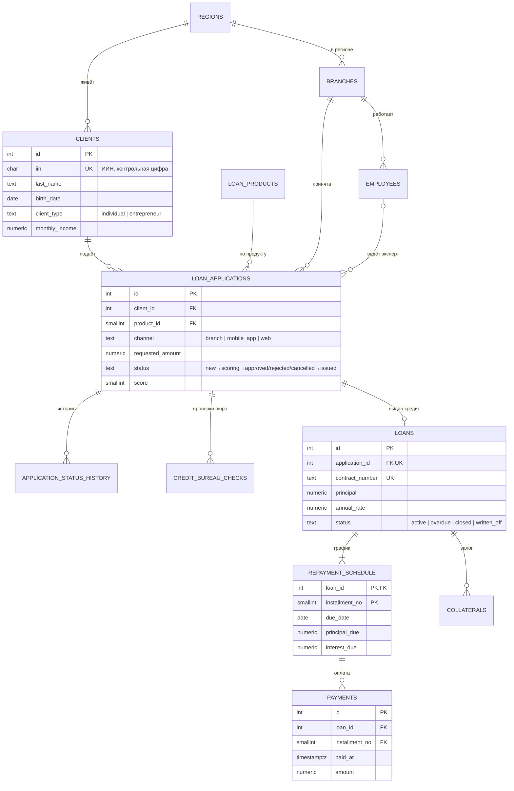

# Урок 01. Проектирование БД с нуля: ER-диаграмма

Занятие курса: 25 ноября 2026 (есть в записи до 1 февраля 2027). Физическая модель: [`sql/01_schema.sql`](../sql/01_schema.sql).

## БД и СУБД

- **База данных** — организованный набор данных (клиенты, заявки, платежи).
- **СУБД** — программа, которая хранит БД и выполняет запросы к ней: PostgreSQL, Oracle, MS SQL, MySQL.
- **DBeaver** — не СУБД, а клиент: окно, через которое ты подключаешься к СУБД и пишешь запросы.

## Три уровня модели

| Уровень | Что описывает | Пример из кредитного модуля |
|---|---|---|
| Концептуальная | сущности и связи словами | «Клиент подаёт заявку, по одобренной заявке выдаётся кредит» |
| Логическая | сущности, атрибуты, ключи, кардинальности; без типов СУБД | Кредит(номер договора, сумма, ставка, срок, статус); Заявка 1 — 0..1 Кредит |
| Физическая | таблицы, типы, ограничения, индексы конкретной СУБД | `loans.principal numeric(14,2) NOT NULL CHECK (principal > 0)` |

## Задание: выдели сущности из описания бизнеса

> Банк выдаёт кредиты физическим лицам и индивидуальным предпринимателям. Клиент обращается в
> филиал к кредитному эксперту или подаёт заявку в мобильном приложении. В заявке указывает
> продукт, сумму, срок и цель. По каждой заявке банк запрашивает кредитные бюро (ПКБ, иногда ГКБ),
> считает скоринговый балл и принимает решение: одобрить, отказать (с причиной) или клиент сам
> отменяет заявку. Все смены статуса должны сохраняться для аудита. По одобренной заявке
> заключается договор и выдаётся кредит. Для кредита строится ежемесячный график платежей.
> Клиент платит через приложение, терминал, в отделении или автосписанием. Для агрокредитов
> и крупных кредитов ИП нужен залог с оценочной стоимостью. У продукта есть лимиты суммы и
> срока, ставка; некоторые продукты доступны только женщинам-предпринимателям. Филиалы
> находятся в регионах; клиент тоже относится к региону.

1. Выпиши существительные → кандидаты в сущности. Отбрось то, что является атрибутом (сумма, срок, ставка).
2. Для каждой сущности — атрибуты и ключ. Есть ли естественный ключ (ИИН, номер договора)? Почему всё
   равно лучше суррогатный `id`?
3. Определи связи и кардинальности: клиент–заявка, заявка–кредит, кредит–график, строка графика–платёж,
   кредит–залог.
4. Где нужна отдельная таблица истории, а где хватит колонки?
5. Нарисуй ER-диаграмму (draw.io, Miro или бумага), потом сравни с ответом ниже.

## Ответ: ER-диаграмма песочницы

GitHub и многие редакторы Markdown рисуют её автоматически (Mermaid).



Решения, которые стоит уметь объяснить на собеседовании:

- **Заявка и кредит — разные сущности.** У заявки свой жизненный цикл (статусы, отказы), кредит
  появляется только у выданных. Связь 1 — 0..1, `loans.application_id UNIQUE`.
- **Клиент у кредита берётся через заявку.** Это 3NF без дублирования; цена — лишний JOIN (урок 08).
  В микросервисах наоборот денормализуют (урок 03).
- **График — отдельная таблица с составным ключом** `(loan_id, installment_no)`; платёж ссылается на
  конкретную строку графика. В песочнице на одну строку приходится один платёж, но схема допускает
  несколько (частичная оплата), поэтому связь 1:N.
- **Ответ бюро хранится как `jsonb`:** структура чужая и меняется без нас, а нам нужен оригинал
  для аудита (урок 07).
- **Деньги — `numeric(14,2)`, не `float`:** float теряет копейки.
- **Статусы — текст с `CHECK`**, а не свободная строка: опечатка `'aproved'` не пройдёт.

## ER-диаграмма в DBeaver

Правый клик по схеме `credit` → **View Diagram**. DBeaver строит диаграмму по внешним ключам.
Её можно сохранить как картинку (кнопка экспорта на панели диаграммы) и вставить в требования.

## Шаблон постановки задачи на разработчиков: новая таблица

```
Таблица: <схема.имя>  — <назначение одной фразой>
Владелец данных: <сервис/команда>
Колонки:
| Колонка | Тип | NULL | По умолчанию | Ограничение | Описание / пример |
Ключи: PK <…>; UK <…>; FK <колонка → таблица.колонка, ON DELETE …>
Индексы: <колонки, зачем (какой запрос)>
Объём и рост: <строк сейчас / в год>, срок хранения <…>
Кто пишет / кто читает: <сервисы, отчёты, интеграции>
Персональные данные: <какие колонки, маскирование, доступ>
Миграция существующих данных: <нужна/нет, см. урок 02>
Критерии приёмки: <запросы-проверки>
```
